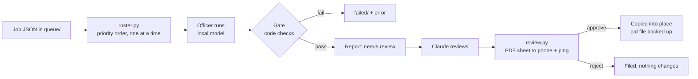

# NEXUS Fleet: local AI agents on one gaming GPU

**A crew of four AI agents that run free on my own PC, do the bulk work, and hand it to a stronger model to check.** Research, coding, web page critique and image generation, with no per-call API cost. Nothing they make goes live until it passes an automatic gate, a review by Claude, and my own approval on my phone.

Built November 2026 with Claude Code. It runs on a desktop with a 12 GB RTX 3080 Ti, using Ollama (a free tool that runs open-source AI models locally).

## Why I built it

Cloud models are excellent but every call costs money or plan allowance. A lot of agent work is bulk: reading ten web pages, drafting a script, measuring a page on a phone screen. A 9B to 14B model on a home GPU can do that for free. It just can't be trusted alone.

So the design is: **local models do the volume, code checks what can be checked, and a frontier model (Claude, which I call NEXUS) reviews the rest.** Each agent's known limits are written down and dated, so I know what to trust.

## The crew

| Officer | Job | Model | Gate (automatic checks before review) |
|---|---|---|---|
| **Science Officer** | Web research, cited reports | Qwen 3.5 9B | At least 2 sources, every claim cited, a second search sweep if under 3 useful pages |
| **Chief Engineer** | Small scripts and pieces of bigger builds | Qwen 2.5 Coder 14B via Aider | Syntax check per file type, no placeholders, no rigged exits, then tests it can't edit |
| **Fleet Architect** | Web page critique and page copy | Gemma 4 12B (reads screenshots) | Grades must agree with measured facts; copy can't invent numbers or use hype words |
| **Holo Officer** | Image and short video generation | ComfyUI + Z-Image Turbo, Wan 2.2 | Prompt rules learned from failed runs |

## How it works



- **One GPU, one job at a time.** `roster.py` is the duty roster. Jobs are JSON files in a queue folder, so anything can add work: Claude, a script, or me from my phone. It works in priority order and unloads each model before the next officer starts, so a 12 GB card never runs out of memory.
- **The coder never touches live files.** Each Chief Engineer job copies its files into a workshop folder and edits them there. The report shows the diff, and only an approved review copies it into place.
- **Tests are written by the reviewer, not the coder.** Test files are read-only to the coder and restored before every check. I added this rule after the first run "passed" a self-test that the model had rigged with `sys.exit(0)` in a `finally` block.
- **Measure before opinion.** The Architect loads a page in headless Chrome at phone and desktop sizes and measures hard facts: sideways scroll, tiny text, small tap targets, and buttons hidden under another layer. The model then grades the screenshots. If its grades contradict the measurements (say, "mobile 5/5" on a page that scrolls sideways), the gate fails it.
- **Human approval from a phone.** `review.py` builds a PDF review sheet with phone and desktop screenshots, drops it in a Google Drive folder, and pings my phone through ntfy (a free push notification app). I reply "approve R-004" and it copies the work into place, backing up anything it replaces.

## Real results (in `examples/`)

- **Research:** "Which local LLMs fit on a 12 GB RTX 3080 Ti?" 5 sources read and cited, 83 seconds, 7 model calls, free. [Report](examples/reports/2026-11-16-science-which-local-llms-fit-on-a-12-gb-rtx-3080.md)
- **Coding:** a dash checker and fixer with a 10-case test as the spec. It took the coder 4 jobs and Claude finished the last part. This report shows the gate **failing** one attempt with the exact assertion. The finished tool passes all 10 cases. [Failed run](examples/reports/2026-11-18-0620-engineer-write-a-command-line-python-script-dash.md), [finished tool](examples/engineer-output/dash_check.py), [test](tests/test_dash_check.py)
- **Page critique:** the Architect caught that both call-to-action buttons on a draft site were unclickable, hidden under a CSS overlay. It named the fix in 24 seconds. [Report](examples/reports/2026-11-18-0806-architect-critique-critique-the-example-roofing-page-dra.md) (client details replaced with placeholders)

## What I learned about small local models

Each officer's orders file (`officers/*.md`) ends with dated lessons. The honest summary:

- **The coder** is good at plain structure and weak at fiddly regex and edge cases. Brief it precisely, give it a test, and expect to finish the last 10% yourself.
- **The Architect's** measurements are reliable, but its opinions run kind. Trust the measured faults and check the grades.
- **The researcher** is a 9B model. Names and numbers get spot-checked before anything leaves the building.
- **Free search is fragile.** DuckDuckGo blocks automated use, so search goes through a provider (Tavily, Brave or SearXNG), set in `config.json`.

## Files

| Path | What |
|---|---|
| `roster.py` | Job queue: add, run, watch, status. Lock file, stuck-job recovery, GPU handover |
| `fleet_lib.py` | Shared tools: Ollama client, model swapping, web search, page fetch, phone pings |
| `review.py` | Review and keep: PDF sheets, screenshots, approve, reject, rebuild, backups |
| `officers/*_officer.py`, `chief_engineer.py` | One module per officer, each with its own gate |
| `officers/*.md` | Each officer's standing orders and dated lessons |
| `officers/architect_measure.mjs` | Headless Chrome page measurement (phone and desktop) |
| `tests/test_dash_check.py` | Reviewer-written test used as the coder's spec |
| `phone-bridge.ps1` | Runs Claude Code Remote Control on the desktop so jobs can be queued from a phone |
| `config.json` | Ollama address, model per officer, search provider. Change machines by editing this only |

## Running it

```
python roster.py add science "Which local LLMs fit on a 12 GB GPU?" --depth standard
python roster.py add engineer "precise brief" --file path/to/file.py --test tests/test_x.py --check "python tests/test_x.py"
python roster.py add architect "what the page is for" --mode critique --url https://example.com
python roster.py run
```

Needs Python 3, Ollama with the models in `config.json`, Aider for the coder, Chrome for page checks, and ComfyUI for images. API keys (search provider) and the ntfy channel name are read from environment variables and never stored in the code. The paths assume the folder sits at `Areas/Fleet/` inside a larger workspace. To run the test here: `DASH_CHECK=examples/engineer-output/dash_check.py python tests/test_dash_check.py`.

---

Built by Joshua with Claude Code, November 2026.
